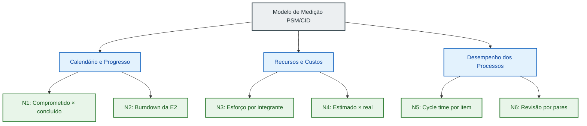

# Gestão do Projeto com Métricas PSM/CID

Esta página documenta como a equipe **Frans Bilas (Turma 01)** mede a própria execução na disciplina **Qualidade de Software 1 (FGA0315 - 2026.2)**. O GQM fica com a avaliação do produto (Brasil Participativo). A gestão interna segue o **PSM (*Practical Software Measurement*)** e o guia **CID (*Continuous Iterative Development*)**.

A base desta página é o guia CID (Partes 1 e 2), o livro de McGarry et al. (cap. 1 e 2) e a Aula 09 da disciplina. Na versão 1.0, a página tinha as três categorias do PSM, mas não seguia o modelo de informação nem o processo de medição. A versão 2.0 corrige isso, e a adequação termina na release da Entrega 2, em 21/11, um dia antes da entrega final de 22/11.

---

## 1. Diagnóstico da versão 1.0

A Tabela 1 compara cada elemento do PSM com o estado da página em 26/10.

**Tabela 1**: Diagnóstico da versão 1.0 diante dos elementos do PSM.

| Elemento do PSM | O que o material pede | Estado na versão 1.0 | Situação |
| :--- | :--- | :--- | :---: |
| Categorias de informação | Agrupar as necessidades nas categorias do PSM (McGarry, cap. 2, §2.1) | Recursos e Custos, Calendário e Progresso, Desempenho dos Processos | Adequado |
| Necessidades de informação | Partir de problemas, riscos e falta de informação do projeto (McGarry, §2.1) | Não escritas; aparecem só no plano de sprints | Falta |
| Seleção das medidas | Escolher na tabela ICM um conjunto mínimo e adaptado (CID P1, §5 e §7) | Escolha própria; TCS e HTM coincidem com as linhas 1 e 7 | Parcial |
| Construto de medição | Entidade, atributo, medida básica, método, escala, unidade, função, indicador, modelo de análise e critério (McGarry, §2.2; Aula 09, slide 19) | Só conceito, fórmula, fonte e meta | Parcial |
| Critérios de decisão | Limites que disparam ação, tirados de histórico, plano ou heurística (McGarry, §2.2) | Metas próprias sem origem declarada | Parcial |
| Coleta | Automatizada e integrada ao fluxo de trabalho (CID P1, §5) | Horas estimadas, TRP sem valor, nenhuma tag de release | Falta |
| Indicador por iteração | Comparar obtido com esperado a cada iteração (CID P2, §8.3) | Um valor por métrica no Sprint 1 | Falta |
| Processo de medição | Comprometer, planejar, executar e avaliar (McGarry, cap. 1, §1.6) | Planejamento feito no plano de sprints; execução parcial | Parcial |

Fonte: elaborado pela equipe a partir do guia CID, de McGarry et al. e da Aula 09.

### 1.1 Correções do Ponto de Controle 1

A correção pedida no PC1 foi a gestão: a versão 1.0 tinha as categorias do PSM, mas não o modelo de informação nem o processo de medição. A versão 2.0 (PR #86, 26/10) trata cada item marcado como Falta ou Parcial na Tabela 1, como mostra a Tabela 2.

**Tabela 2**: Correções do PC1 na gestão, da versão 1.0 para a 2.0.

| Elemento do PSM | Situação na 1.0 | O que a 2.0 fez | Onde está |
| :--- | :---: | :--- | :--- |
| Necessidades de informação | Falta | Seis necessidades, N1 a N6, cada uma ligada a um problema, risco ou falta de informação do projeto | [Seção 2](#2-necessidades-de-informacao) |
| Seleção das medidas | Parcial | Cinco indicadores da tabela ICM e uma adaptação declarada (N6) | [Seção 3](#3-indicadores-selecionados) |
| Construto de medição | Parcial | Construto completo para os seis indicadores, da entidade ao critério de decisão | [Seção 4](#4-construtos-de-medicao) |
| Critérios de decisão | Parcial | Limites com origem citada no guia; os de N3 e N4 foram definidos na Seção 10 | [Seção 4](#4-construtos-de-medicao) e [Seção 10](#10-pontos-em-validacao) |
| Coleta | Falta | GitHub Projects 33 com os campos das medidas básicas e regras de registro (issues #41 e #42) | [Seção 6](#6-coleta-de-dados) |
| Indicador por iteração | Falta | Série medida a partir do Sprint 3, com uma medição por sprint até a E2 | [Seção 7](#7-acompanhamento-dos-sprints) |
| Processo de medição | Parcial | As quatro atividades do PSM, cada uma com responsável e prazo | [Seção 5](#5-processo-de-medicao) |

Fonte: Tabela 1 e PR #86.

---

## 2. Necessidades de informação

Seis perguntas de gestão guiam a medição, duas por categoria. Cada uma nasce de uma questão do projeto, classificada nos três tipos de McGarry (cap. 2, §2.1): problema, risco ou falta de informação. A Tabela 3 lista as seis, e a Figura 1 as agrupa por categoria.

**Tabela 3**: Necessidades de informação da gestão.

| ID | Categoria | Necessidade de informação | Questão do projeto que a origina | Tipo |
| :---: | :--- | :--- | :--- | :---: |
| **N1** | Calendário e Progresso | Os itens comprometidos em cada sprint são entregues? | Itens do Sprint 1 fechados na madrugada do prazo | Problema |
| **N2** | Calendário e Progresso | A Entrega 2 será concluída até a release de 21/11? | Atraso custa 50% da nota por dia e não há substitutiva | Risco |
| **N3** | Recursos e Custos | Quanto esforço cada integrante investe, e a divisão está equilibrada? | Tabela de contribuição feita por acordo, sem horas registradas | Falta de informação |
| **N4** | Recursos e Custos | Nossas estimativas de esforço são precisas? | Sprints 3 a 5 têm cerca de uma semana cada e duas melhorias técnicas | Risco |
| **N5** | Desempenho dos Processos | Quanto tempo um item leva do início à conclusão? | Trabalho acumulado no fim do sprint | Problema |
| **N6** | Desempenho dos Processos | Todo trabalho passa por revisão de outra dupla antes do merge? | Até 26/10, 39 das 42 integrações na `main` entraram sem PR | Problema |

Fonte: elaborado pela equipe.

**Figura 1**: Necessidades de informação por categoria do PSM.



Fonte: elaborado pela equipe.

---

## 3. Indicadores selecionados

Cinco indicadores vêm da tabela ICM do guia. O sexto é adaptação da equipe, como o guia permite: "um conjunto mínimo prático de medidas deve ser selecionado e adaptado" (CID P1, §5). A Tabela 4 mostra a origem de cada um.

**Tabela 4**: Indicadores selecionados e sua origem no guia CID.

| Necessidade | Indicador | Linha ICM (CID P1, Tab. 5) | Especificação no guia | Substitui |
| :---: | :--- | :--- | :--- | :---: |
| N1 | Comprometido × concluído por sprint | 1 (*Work Unit Progress*) | CID P2, §8.3 | TCS |
| N2 | Burndown do milestone E2 | 1 (*Work Unit Progress*) | CID P2, §8.2 | IAP |
| N3 | Esforço por integrante | 7 (*Financial Performance, Effort*) | CID P1, Tab. 5 | HTM e PCI |
| N4 | Esforço estimado × real | 8 (*Estimate vs. Actual Effort*) | CID P1, Tab. 5 | Novo |
| N5 | Cycle time por item | 32 (*Process Efficiency, Speed*) | CID P2, §8.5 | Novo |
| N6 | Revisão por pares | Adaptação; próxima da linha 18 (rework identificado e gerenciado) | Construído pela equipe | TRP |

Fonte: elaborado pela equipe a partir do guia CID, Parte 1, Tab. 5.

O que aconteceu com as métricas da versão 1.0:

- **Taxa de Conclusão de Sprints (TCS)** virou o comprometido × concluído do guia, com a mesma conta e o critério da Parte 2.
- **Índice de Aderência a Prazos (IAP)** saiu. O burndown da E2 responde a mesma pergunta antes do prazo, e não depois.
- **Horas Trabalhadas por Membro (HTM)** e **Percentual de Contribuição Individual (PCI)** viraram um só indicador de esforço, com horas reais.
- **Taxa de Revisão por Pares (TRP)** ficou como adaptação, agora com dado coletado.
- **Conformidade com Diretrizes Anti-Meat-Proxy (CAMP)** deixou de ser indicador e entrou no critério de Pronto. A Parte 2 só conta um item como concluído quando ele satisfaz o critério de Pronto (§8.3).

---

## 4. Construtos de medição

Cada indicador segue os elementos do construto de medição (McGarry, cap. 2, §2.2, Fig. 2-3; Aula 09, slide 19). Todos os métodos são objetivos, por contagem ou soma, e todas as escalas são de razão. As Tabelas 5, 6 e 7 trazem o construto de cada par de indicadores.

### 4.1 Calendário e Progresso

**Tabela 5**: Construtos de medição de Calendário e Progresso (N1 e N2).

| Elemento | Comprometido × concluído (N1) | Burndown da E2 (N2) |
| :--- | :--- | :--- |
| Entidade | Issues do sprint | Issues do milestone E2 |
| Atributo | Status no início e no fim do sprint | Status a cada dia |
| Medidas básicas | \(C\) = itens comprometidos; \(D\) = itens concluídos no critério de Pronto | \(P\) = itens planejados; \(D\) = itens concluídos |
| Método | Contagem no GitHub Projects no 1º e no último dia do sprint | Contagem diária no milestone E2 |
| Unidade | Item | Item |
| Medida derivada | \(\%_{\text{concl}} = \frac{D}{C} \times 100\) | \(\text{Aberto} = P - D\) |
| Indicador | Barras por sprint (comprometido e concluído) e % acumulado | Linha do trabalho em aberto até 21/11 |
| Modelo de análise | \(\text{Desvio} = 100\% - \%_{\text{concl}}\) | Comparação do aberto com os dias que restam |
| Critério de decisão | Desvio acima de 5%: investigar a causa; acima de 10%: ação corretiva (CID P2, §8.3) | Variância acima de 5%: revisar na reunião; acima de 10%: replanejar escopo (CID P2, §8.2) |

Fonte: elaborado pela equipe a partir de McGarry et al. (cap. 2, §2.2) e do guia CID, Parte 2.

### 4.2 Recursos e Custos

**Tabela 6**: Construtos de medição de Recursos e Custos (N3 e N4).

| Elemento | Esforço por integrante (N3) | Estimado × real (N4) |
| :--- | :--- | :--- |
| Entidade | Issues concluídas com horas | Issues concluídas com horas |
| Atributo | Horas gastas e responsável | Horas estimadas e horas gastas |
| Medidas básicas | \(R\) = horas reais por item | \(E\) = horas estimadas; \(R\) = horas reais |
| Método | Campo "Esforço real" preenchido ao fechar a issue | Campos "Esforço estimado" e "Esforço real" |
| Unidade | Hora | Hora |
| Medida derivada | Total por pessoa e \(\%_i = \frac{R_i}{\sum_j R_j} \times 100\) | \(\text{Precisão} = \frac{R}{E} \times 100\) |
| Indicador | Barras por integrante por sprint | Precisão por sprint |
| Modelo de análise | Participação comparada à divisão esperada de 1/6 (16,7%) | Acima de 100%: a equipe subestimou; abaixo: superestimou |
| Critério de decisão | Participação abaixo de 10% ou acima de 25% no sprint leva à conversa na reunião (critério por acordo da equipe, Aula 09, slide "Critérios de decisão"; [fechado na Seção 10](#10-pontos-em-validacao)) | Fora de 80% a 120%: rever a forma de estimar (adaptado da Fig. 26, CID P2, §9.2; [fechado na Seção 10](#10-pontos-em-validacao)) |

Fonte: elaborado pela equipe a partir de McGarry et al. (cap. 2, §2.2) e do guia CID, Parte 2.

### 4.3 Desempenho dos Processos

**Tabela 7**: Construtos de medição de Desempenho dos Processos (N5 e N6).

| Elemento | Cycle time (N5) | Revisão por pares (N6) |
| :--- | :--- | :--- |
| Entidade | Issues concluídas | Integrações na `main` |
| Atributo | Data de início e de conclusão | Revisão aprovada por outra dupla |
| Medidas básicas | Início; Fim | \(T\) = integrações (PRs + commits diretos); \(V\) = PRs revisados por outra dupla |
| Método | Datas registradas na issue | Contagem no histórico da `main` e nas revisões dos PRs |
| Unidade | Dia | Integração |
| Medida derivada | \(\text{Tempo} = \text{Fim} - \text{Início} + 1\) | \(\%_{\text{rev}} = \frac{V}{T} \times 100\) |
| Indicador | Tempo por item e média do sprint | % revisado por sprint |
| Modelo de análise | Distância de cada item até a média | Todo item não revisado conta como exceção |
| Critério de decisão | Item mais de 10% acima da média: investigar (CID P2, §8.5) | Abaixo de 100%: o item não conta como Pronto e a `main` passa a exigir PR |

Fonte: elaborado pela equipe a partir de McGarry et al. (cap. 2, §2.2) e do guia CID, Parte 2.

### 4.4 Critério de Pronto

A contagem de \(D\) em N1 e N2 só inclui itens que cumprem as duas condições:

1. PR revisado por alguém de outra dupla.
2. Verificação anti-IA (`python3 scripts/check_humanizer.py`) aprovada.

---

## 5. Processo de medição

A medição segue as quatro atividades do modelo de processo do PSM (McGarry, cap. 1, §1.6), repetidas a cada sprint (Tabela 8).

**Tabela 8**: Atividades do processo de medição.

| Atividade do PSM | O que a equipe faz | Responsável | Quando |
| :--- | :--- | :--- | :--- |
| Estabelecer e manter o compromisso | Regras de registro publicadas nesta página; responsável fixo pela coleta | Dupla 3; coordenação: Mateus | Uma vez, e revisto no fim de cada sprint |
| Planejar a medição | Necessidades N1 a N6, indicadores da tabela ICM e construtos descritos nesta página | Dupla 3 com Mateus | Até 29/10 |
| Executar a medição | Coleta no GitHub Projects; análise nos encontros de segunda e quarta; decisão registrada em [ata](atas/index.md) | Dupla 3 coleta; equipe analisa | A cada sprint |
| Avaliar a medição | Verificar quais indicadores apoiaram decisões; trocar os que não foram usados, registrando o motivo | Equipe toda | Fim de cada sprint |

Fonte: elaborado pela equipe a partir de McGarry et al. (cap. 1, §1.6).

O guia pede que as medidas sejam revistas para garantir que estão em uso; se não estiverem, outras medidas podem ser necessárias (CID P1, §2). A avaliação no fim de cada sprint cumpre esse papel.

---

## 6. Coleta de dados

A coleta passa para o GitHub Projects porque o guia pede que ela seja "automatizada até onde for prático e integrada ao fluxo de trabalho" (CID P1, §5). McGarry recomenda padronizar as medidas básicas e deixar os indicadores flexíveis (cap. 2, §2.2).

O quadro da equipe é o Project [FRANS BILAS - Brasil Participativo](https://github.com/orgs/FCTE-Qualidade-de-Software-1/projects/33), ligado a este repositório. Ele reúne as issues do PC1, fechadas com quem fez cada item como responsável, e o backlog dos Sprints 3 a 6, tirado do Plano de Sprints de 14/10.

A Tabela 9 lista os campos de cada issue, que são as medidas básicas.

**Tabela 9**: Campos das issues no GitHub Projects 33.

| Campo | Tipo | Alimenta |
| :--- | :---: | :---: |
| Status (Backlog, Em andamento, Em revisão, Pronto) | Seleção | N1, N2 |
| Sprint | Iteração | N1, N3, N4 |
| Milestone (E2) | Marco | N2 |
| Responsável | Pessoa | N3 |
| Esforço estimado (h) | Número | N4 |
| Esforço real (h) | Número | N3, N4 |
| Início e Conclusão | Data | N5 |

Fonte: GitHub Projects 33.

Regras de registro:

1. Uma issue por item de trabalho, com um responsável. Trabalho em dupla vira uma issue por pessoa, para não contar a mesma hora duas vezes.
2. As horas vão para o campo "Esforço real" ao fechar a issue, e nunca são estimadas depois.
3. Um item só conta como concluído quando cumpre o [critério de Pronto](#44-criterio-de-pronto) (CID P2, §8.3).
4. A `main` passa a aceitar só PRs, o que torna a revisão por pares mensurável.
5. O modelo de registro não muda dentro de um sprint. Mudanças entram no sprint seguinte, com o motivo em ata.

**Sprints 1 e 2.** Os dados existentes são estimativas e ficam marcados assim nesta página. Eles servem de linha de base e não entram nos critérios de decisão. A série medida começa no Sprint 3.

---

## 7. Acompanhamento dos sprints

A Tabela 10 resume o foco, a situação e a medição de cada sprint.

**Tabela 10**: Sprints do projeto.

| Sprint | Período | Foco temático e entregáveis | Status | Medição |
| :---: | :---: | :--- | :---: | :--- |
| **Sprint 1** | 14/10 a 19/10 | Fase 1 completa, estruturação da GitPage, slides e apresentação do PC1. | **Concluído** | Linha de base (estimativa): 100% dos itens do plano concluídos |
| **Sprint 2** | 20/10 a 25/10 | Fase 2 (GQM), Gestão PSM/CID, artigo científico v1 e Release E1. | **Concluído** | Linha de base (estimativa) |
| **Sprint 3** | 27/10 a 04/11 | Fase 3: Plano de Avaliação, recursos de teste e apresentação das métricas PSM (04/11 ou 11/11). | **Concluído** | 1ª medição de N1 a N6 em 04/11 ([Seção 12](#12-medicao-do-sprint-3)) |
| **Sprint 4** | 05/11 a 11/11 | Execução da coleta, consolidação de dados brutos e primeira melhoria técnica. | **Concluído** | Dados consolidados diretamente nas issues do Projects |
| **Sprint 5** | 12/11 a 21/11 | Fase 4: julgamento, segunda melhoria técnica, artigo v2, Ponto de Controle 2 (16/11 ou 18/11) e release E2 em 21/11. | **Em andamento** | Medição final na release E2 |
| **Sprint 6** | 22/11 a 02/12 | Entrega final (22/11), apresentações finais (23/11, 25/11 e 30/11), 2ª Avaliação Cruzada e Autoavaliação 2 (até 02/12). | Planejado | Continuação da série |

Fonte: Plano de Sprints de 14/10 e GitHub Projects 33.

O diretório [`dados/gestao/`](dados/gestao/) guarda o arquivo bruto da medição do Sprint 3. Como os dados dos Sprints 4 e 5 não foram consolidados em arquivos locais próprios, os indicadores formais N1 a N6 desses períodos não aparecem em tabelas estáticas. As horas reais de N3 e N4 exigem preenchimento direto nas issues fechadas do GitHub Projects, e o painel automatizado da Seção 9 já extrai esses números continuamente.

Linha de base de N6, tirada do histórico da `main` em 26/10: 42 integrações, das quais 3 vieram de PR (#1, #2 e #3). Nenhum dos três PRs tem revisão registrada no GitHub, então \(V = 0\) e \(\%_{\text{rev}} = \frac{0}{42} \times 100 = 0\%\).

O planejamento do Sprint 3 foi feito na reunião de 29/10 ([Ata 02](atas/index.md)). Em 30/10, o backlog foi redistribuído por pessoa: 18 issues e 31 horas estimadas, uma issue por responsável, como pede a regra 1 da coleta. A carga de Mateus (8 h) passa do teto de 25% proposto para N3, por decisão dele como líder, registrada na mesma ata.

---

## 8. Tabela de Contribuição da Equipe (Critério AG-C5)

**Tabela 11**: Contribuição da equipe na Entrega 1.

| Integrante | Usuário GitHub | Papel no Projeto | Principais Responsabilidades e Entregáveis | Horas Estimadas | Esforço real | Participação estimada (%) |
| :--- | :--- | :--- | :--- | :---: | :---: | :---: |
| **João Victor da Silva Batista de Farias** | [@BeyondMagic](https://github.com/BeyondMagic) | Dupla 1 (Qualidade/GQM) | Propósito da avaliação, partes interessadas, contextualização técnica, arquitetura do software, estruturação do artigo em LaTeX IEEEtran, introdução, metodologia, governança anti-meat-proxy e estimativa de esforço do backlog no Projects. | 39,0h | 13,2h | **36,3%** |
| **Lucca Medeiros Silva** | [@luccameds](https://github.com/luccameds) | Dupla 2 (GQM/Métricas) | Fichas técnicas das doze métricas quantitativas, formulação matemática com MathJax, níveis de pontuação, critérios de julgamento, grafo GQM completo e matriz de rastreabilidade vertical. | 20,0h | 6,7h | **18,4%** |
| **José Vinícius Alvares Soares de Queiroz** | [@JoseViniciusQueiroz](https://github.com/JoseViniciusQueiroz) | Dupla 2 (GQM/Métricas) | Levantamento do referencial teórico (SQuaRE, GQM e PSM), objetivos conceituais GQM, questões operacionais, hipóteses iniciais, apoio na priorização da Fase 1 e correção técnica do Rails. | 18,0h | 6,0h | **16,3%** |
| **Miguel Arthur Oliveira de Lima** | [@zlimaz](https://github.com/zlimaz) | Dupla 3 (Gestão/Infra) | Concepção do modelo de qualidade SQuaRE adaptado, diagrama hierárquico em Mermaid, matriz de priorização ponderada e trade-offs, modelo inicial PSM/CID e referências cruzadas no artigo. | 12,0h | 4,1h | **11,1%** |
| **Mateus Vinícius Vieira** | [@matix0](https://github.com/matix0) | Dupla 1 (Qualidade/GQM) | Coordenação geral do backlog e sprints, estruturação da gestão do projeto adequada ao PSM/CID e elaboração do Termo de Consentimento Livre e Esclarecido (TCLE) para testes de usabilidade. | 10,0h | 3,4h | **9,3%** |
| **Davi Mesquita Sousa** | [@davimesquit](https://github.com/davimesquit) | Dupla 3 (Gestão/Infra) | Delimitação de escopo, profundidade e objetos de avaliação, alinhamento aos ODS e metas, alinhamento de seções e slides com a Fase 1 e revisão de sumário e referências do artigo. | 9,0h | 3,1h | **8,5%** |
| **TOTAL** | - | **Esforço Coletivo Consolidado** | **Execução das atividades da Entrega 1 registradas no GitHub Projects 33** | **108,0h** | **36,4h** | **100,00%** |

Fonte: GitHub Projects 33, issues do milestone E1 (PC1).

---

## 9. Painel Automatizado de Métricas e Indicadores de Processo

Para manter a coleta de dados contínua e sem etapas manuais, como recomendam McGarry et al. (cap. 2, §2.2) e o guia CID (Parte 1, §5), a rotina [.github/scripts/update_metrics.py](https://github.com/FCTE-Qualidade-de-Software-1/2026-2_T01_FRANS_BILAS/blob/main/.github/scripts/update_metrics.py) extrai os dados do repositório Git e da API do GitHub Projects. O workflow do GitHub Actions (`.github/workflows/metrics.yml`) roda esse script a cada push nas branches principais e atualiza os arquivos em `documentation/snippets/management/`.

De onde vem cada dado:

- **Commits e linhas alteradas**: histórico de commits do Git.
- **Issues abertas e fechadas por integrante**: contagem direta das issues do repositório.
- **Horas estimadas e reais**: campos do GitHub Projects 33. Como o token padrão do GitHub Actions não tem permissão para ler projetos da organização, o repositório usa o segredo `PROJECTS_TOKEN`. Se esse token não estiver configurado, as colunas de horas mostram "sem acesso".

Até 04/11, quando a consulta ao Projects falhava, o script usava valores fixos no código. Por isso as Tabelas 12 e 13 e as Figuras 2 e 3 ficaram paradas nos números de 27/10. Essa falha foi identificada na medição do Sprint 3 e resolvida na issue #106: agora, se a leitura das issues falhar, o script interrompe o processo sem gravar dados desatualizados.

### 9.1 Resumo de atividade e esforço por integrante

A Tabela 12 reúne a contagem de commits, as linhas adicionadas e removidas e o total de issues atribuídas a cada membro da equipe, com as horas estimadas e reais registradas no Projects.

**Tabela 12**: Commits, linhas alteradas e issues por integrante.

--8<-- "management/contributions-summary.md"

Fonte: gerado por `.github/scripts/update_metrics.py`.

### 9.2 Distribuição do backlog e tarefas concluídas

A Tabela 13 e os gráficos das Figuras 2 e 3 mostram como as issues estão distribuídas entre os membros e quantas tarefas cada um já concluiu.

**Tabela 13**: Issues abertas e fechadas por integrante.

--8<-- "management/issues-summary.md"

Fonte: gerado por `.github/scripts/update_metrics.py`.

#### Issues Atribuídas por Integrante
**Figura 2**: Issues atribuídas por integrante.

```mermaid
--8<-- "management/assigned-issues.mmd"
```

Fonte: gerado por `.github/scripts/update_metrics.py`.

#### Tarefas Resolvidas por Integrante
**Figura 3**: Tarefas resolvidas por integrante.

```mermaid
--8<-- "management/resolved-issues.mmd"
```

Fonte: gerado por `.github/scripts/update_metrics.py`.

### 9.3 Dinâmica semanal de commits e evolução do código

As Figuras 4, 5 e 6 mostram a frequência dos commits ao longo das semanas e o volume de código adicionado e removido por cada integrante:

#### Velocidade Semanal de Commits
**Figura 4**: Commits por semana.

```mermaid
--8<-- "management/commit-velocity.mmd"
```

Fonte: gerado por `.github/scripts/update_metrics.py`.

#### Adições de Linhas de Código
**Figura 5**: Linhas de código adicionadas por integrante.

```mermaid
--8<-- "management/code-additions.mmd"
```

Fonte: gerado por `.github/scripts/update_metrics.py`.

#### Remoções e Limpeza de Código
**Figura 6**: Linhas de código removidas por integrante.

```mermaid
--8<-- "management/code-deletions.mmd"
```

Fonte: gerado por `.github/scripts/update_metrics.py`.

---

## 10. Deliberações e fechamento dos pontos em validação <a id="10-pontos-em-validacao"></a>

**Responsável**: Miguel Arthur Oliveira de Lima (Dupla 3)

Na reunião de 29/10 ([Ata 02](atas/index.md)), alguns critérios práticos e detalhes de divisão ficaram pendentes. A **issue #44** fechou essas definições para homologação na Ata 03 (planning do Sprint 4, issue #94):

1. **Esforço por integrante (N3)**:
   - **Faixa de controle**: participação entre **10% e 25%** do esforço total do sprint por pessoa.
   - **Justificativa**: com seis integrantes divididos em três duplas, a média teórica seria de 16,7% cada ($100\% / 6$). A faixa de 10% a 25% absorve variações comuns de complexidade entre tarefas sem sobrecarregar ninguém. Casos pontuais combinados com antecedência, como as 8 horas que Mateus assumiu no Sprint 3 para preparar os slides, continuam aceitos se forem anotados na ata da reunião.
2. **Precisão das estimativas (N4)**:
   - **Faixa de controle**: intervalo de **80% a 120%** ($\text{Precisão} = \frac{\text{Estimado}}{\text{Real}} \times 100$).
   - **Justificativa**: o intervalo segue o guia CID (Parte 2, §9.2, Fig. 26). Ele tolera pequenas variações naturais de estimativa enquanto a equipe calibra o ritmo, mas destaca desvios maiores (estimativas abaixo de 80% ou acima de 120%) para ajuste nas reuniões de planejamento dos sprints seguintes.
3. **Divisão de tarefas e apresentação do PC2**:
   - **Coleta de dados**: mantida a organização de 30/10 ([Ata 02](atas/index.md)). A Dupla 3 (Miguel e Davi) conduz o recrutamento e as sessões de usabilidade (issues #67 e #72), a configuração do ambiente local (#64) e as medições PSM (#46, #47 e #48). A Dupla 2 auxilia na análise estática, e a Dupla 1 realiza as revisões cruzadas e a consolidação do texto.
   - **Apresentação do PC2**: a apresentação oral dos slides (issue #70) é dividida igualmente entre as três duplas:
     - Dupla 1 (Mateus e João): introdução, Modelo de Qualidade ISO/IEC 25010:2023 (Fase 1) e GQM (Fase 2).
     - Dupla 2 (José Vinícius e Lucca): análise estática de segurança e manutenibilidade, e propostas de melhoria técnica.
     - Dupla 3 (Miguel e Davi): método das sessões de usabilidade (Fase 3), medições e decisões de gestão PSM/CID (N1 a N6) e conclusão.
4. **Cronograma atualizado da disciplina**:
   - As datas foram alinhadas com a versão 2 do cronograma: Ponto de Controle 2 em 16/11 ou 18/11, release interna da E2 em 21/11, entrega final em 22/11 e apresentações finais da disciplina a partir de 23/11.

---

## 11. Cronograma da adequação

A adequação cabe nos Sprints 3 a 5 e termina com uma série de três sprints medidos na release da E2, em 21/11 (Tabela 14).

**Tabela 14**: Cronograma da adequação ao PSM/CID.

| Prazo | Ação | Responsável | Situação em 04/11 |
| :---: | :--- | :--- | :--- |
| 28/10 | Criar o GitHub Projects com os campos da coleta, as iterações dos Sprints e o milestone E2; cadastrar o backlog do Sprint 3 como issues | Mateus | Concluído em 26/10 (issues #41 e #42) |
| 28/10 | Exigir PR para integrar na `main` | Dupla 3 | Concluído na issue #43: integração na `main` passa obrigatoriamente por pull request com revisão |
| 29/10 | Revisar esta página com a equipe e fechar os [pontos em validação](#10-pontos-em-validacao) | Dupla 3 com Mateus | Concluído na issue #44: critérios de esforço e divisão de papéis fechados na Seção 10 para homologação na Ata 03 |
| 30/10 | Revisar as horas estimadas e redistribuir o Sprint 3 por pessoa | Mateus | Concluído ([Ata 02](atas/index.md), seção 3.6) |
| 04/11 | Fim do Sprint 3: primeira medição completa e avaliação da medição; levar à apresentação das métricas PSM (04/11 ou 11/11) | Equipe | Medição feita em 04/11, com três indicadores sem dado ([Seção 12](#12-medicao-do-sprint-3)) |
| 11/11 | Fim do Sprint 4: segunda medição; ajustar indicadores pouco usados, com motivo em ata | Equipe | Planejado |
| 21/11 | Fim do Sprint 5: série dos Sprints 3 a 5, decisões registradas e tabela de contribuição calculada pelas horas reais, na release E2 | Dupla 3; revisão: Mateus | Planejado |

Fonte: elaborado pela equipe.

A adequação está pronta quando os seis indicadores tiverem valor nos três sprints, cada valor fora do critério tiver uma decisão em ata e a tabela de contribuição sair do indicador de esforço.

---

## 12. Medição do Sprint 3

A primeira medição da série foi feita em 04/11, último dia do sprint, às 03h. O script [`scripts/psm_medicao.py`](https://github.com/FCTE-Qualidade-de-Software-1/2026-2_T01_FRANS_BILAS/blob/main/scripts/psm_medicao.py) lê o GitHub Projects 33, os PRs e o histórico da `main`, e grava os dados brutos e os indicadores em [`dados/gestao/sprint-3.json`](dados/gestao/sprint-3.json). Itens fechados até o fim do dia entram numa nova execução do mesmo script.

O comprometido são as 17 issues listadas por responsável na redistribuição de 30/10 ([Ata 02](atas/index.md), seção 3.6). O texto da ata fala em 18 issues, mas a tabela da mesma seção lista 17, e a medição usa a lista.

### 12.1 Resultados

A Tabela 15 compara cada indicador com o critério de decisão da Seção 4, e a Figura 7 mostra o burndown da E2.

**Tabela 15**: Indicadores do Sprint 3 diante dos critérios de decisão.

| Indicador | Valor medido | Critério de decisão | Resultado |
| :--- | :--- | :--- | :--- |
| N1 Comprometido × concluído | 1 de 17 no critério de Pronto: \(\%_{\text{concl}} = 5{,}9\%\). Fechadas: 6 de 17 (35,3%) | Desvio acima de 10%: ação corretiva | Desvio de 94,1%: ação corretiva |
| N2 Burndown da E2 | 32 de 40 itens abertos em 04/11. Concluídos: 20% dos itens, com 32% do prazo até 21/11 já passado | Variância acima de 10%: replanejar escopo | Variância de 12 pontos percentuais: replanejar |
| N3 Esforço por integrante | Nenhuma das 17 issues tem "Esforço real" preenchido | Participação fora de 10% a 25% | Não calculável |
| N4 Estimado × real | Mesmo motivo de N3 | Precisão fora de 80% a 120% | Não calculável |
| N5 Cycle time | Nenhuma das 6 issues fechadas tem "Início" e "Conclusão" preenchidos | Item mais de 10% acima da média | Não calculável |
| N6 Revisão por pares | 1 de 9 integrações na `main` revisada por outra dupla: \(\%_{\text{rev}} = 11{,}1\%\). Por PR: 7 de 9 | Abaixo de 100%: o item não conta como Pronto e a `main` passa a exigir PR | Abaixo do critério |

Fonte: [`dados/gestao/sprint-3.json`](dados/gestao/sprint-3.json), gerado por `scripts/psm_medicao.py` em 04/11/2026.

Detalhes que explicam os números:

- **N1.** A única issue no critério de Pronto é a #62, fechada pelo PR #92 com revisão de Mateus (Dupla 1) sobre trabalho de José Vinícius (Dupla 2). As #59, #60, #69 e #70 fecharam por PRs sem revisão de outra dupla (#100, #101 e #103), e a #66 pelo PR #104, também sem revisão registrada. Das 11 abertas, 10 não têm branch nem PR; a exceção é a #65 (PR #105).
- **N2.** A variância é a diferença entre a parte do prazo já passada (8 de 25 dias, de 27/10 até a release de 21/11) e a parte dos itens concluída (8 de 40). O guia não fixa essa conta, e a equipe adotou essa. O escopo da E2 cresceu de 33 para 40 itens no sprint: #89 e #90 em 30/10, #93 a #97 em 04/11.
- **N6.** As 9 integrações excluem os commits automáticos do painel (`github-actions[bot]`). As duas que não vieram de PR são commits diretos de 28/10 e 29/10. A revisão do #92 foi registrada como comentário, sem aprovação formal no GitHub.

**Figura 7**: Burndown do milestone E2 acompanhado de 27/10 a 17/11, com itens abertos ao fim de cada dia e a linha ideal até a release de 21/11.

```mermaid
--8<-- "management/burndown-e2.mmd"
```

Fonte: gerado por `.github/scripts/update_metrics.py` a partir das issues do repositório. A linha ideal vai de 31 itens abertos em 27/10 a zero em 21/11.

---

## Referências

- JONES, C. L. et al. *PSM Continuous Iterative Development Measurement Framework, Part 1*, v2.1, 2021: §2 (conceitos), §4 (modelo de informação), §5 (princípios), §7 (tabela ICM, Tab. 5, linhas 1, 7, 8, 18 e 32).
- JONES, C. L. et al. *PSM Continuous Iterative Development Measurement Framework, Part 2*, v2.1, 2021: §8.2 (*Burndown*), §8.3 (*Committed vs. Completed*), §8.5 (*Cycle Time*), §9.2 (Fig. 26, faixas de precisão).
- McGARRY, J. et al. *Practical Software Measurement: Objective Information for Decision Makers*. Addison-Wesley, 2002: cap. 1, §1.6 (modelo de processo); cap. 2, §2.1 (necessidades de informação e categorias) e §2.2 (construto de medição).
- RAMOS, C. S. *Aula 09: PSM (resumo)*. Qualidade de Software 1, UnB/FCTE: slides "Critérios de decisão", "Template para descrever uma instância do modelo de informação" e "Como usar os guias?".

A Parte 3 do guia (garantia de software e dívida técnica) não entra na gestão do projeto. A Aula 09 a trata como complemento opcional, e o tema dela se aplica à avaliação do produto, e não à gestão da equipe.

---

## Histórico de Versões

| Versão | Data | Descrição | Autor | Revisor |
| :---: | :---: | :--- | :--- | :--- |
| `1.0` | 21/10/2026 | Estruturação formal do modelo PSM/CID, métricas de processo e Tabela de Contribuição paritária (100%) | [Miguel Arthur Oliveira de Lima](https://github.com/zlimaz) | A definir |
| `2.0` | 26/10/2026 | Adequação ao PSM/CID: diagnóstico, necessidades N1 a N6, indicadores da tabela ICM, construtos completos, processo de medição, regras de coleta e cronograma até a E2 | [Mateus Vinícius Vieira](https://github.com/matix0) | [João Victor da Silva Batista de Farias](https://github.com/beyondmagic) |
| `2.1` | 26/10/2026 | Inclusão dos nomes e usuários GitHub dos integrantes, e painel automatizado de métricas com gráficos e tabelas de processo | [João Victor da Silva Batista de Farias](https://github.com/beyondmagic) | [Mateus Vinícius Vieira](https://github.com/matix0) |
| `2.2` | 29/10/2026 | Inclusão do gráfico de tarefas resolvidas por integrante no painel automatizado | [João Victor da Silva Batista de Farias](https://github.com/beyondmagic) | [Mateus Vinícius Vieira](https://github.com/matix0) |
| `2.3` | 04/11/2026 | Registro das correções do PC1, situação dos sprints e do cronograma da adequação, pontos em aberto da Ata 02, e legenda, fonte e citação no texto de todas as tabelas e figuras | [Mateus Vinícius Vieira](https://github.com/matix0) | [João Victor da Silva Batista de Farias](https://github.com/beyondmagic) |
| `2.4` | 04/11/2026 | Medição do Sprint 3 (N1 a N6), decisões de gestão e avaliação da medição | [Mateus Vinícius Vieira](https://github.com/matix0) | [João Victor da Silva Batista de Farias](https://github.com/beyondmagic) |
| `2.5` | 04/11/2026 | Origem dos dados do painel automático e correção dos valores fixos (issue #106) | [Mateus Vinícius Vieira](https://github.com/matix0) | [João Victor da Silva Batista de Farias](https://github.com/beyondmagic) |
| `2.6` | 04/11/2026 | Datas do cronograma versão 2 da disciplina: release em 21/11, entrega final em 22/11, PC2 em 16/11 ou 18/11 e apresentação das métricas PSM em 04/11 ou 11/11; N2 recalculado | [Mateus Vinícius Vieira](https://github.com/matix0) | [João Victor da Silva Batista de Farias](https://github.com/beyondmagic) |
| `2.7` | 04/11/2026 | Fechamento dos pontos em validação da Gestão (issue #44): limites de N3 e N4, divisão do PC2 e calendário | [Miguel Arthur Oliveira de Lima](https://github.com/zlimaz) | [João Victor da Silva Batista de Farias](https://github.com/beyondmagic) |
| `2.8` | 17/11/2026 | Registro da ausência de medições publicadas dos Sprints 4 e 5 e distinção entre estimativa e horas reais | Davi Mesquita Sousa | - |
| `2.9` | 17/11/2026 | Humanização da escrita, simplificação de termos e atualização de status dos sprints | [João Victor da Silva Batista de Farias](https://github.com/beyondmagic) | [Mateus Vinícius Vieira](https://github.com/matix0) |
